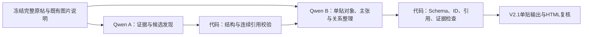

# V2.2 完整改进与拆分说明

先编辑完整契约 `full-v2.2.md`，再从该契约逐节投影生成阶段Prompt。`source-v2.1.md`为用户文件的只读快照。旧candidate-v1、post-pack-v1及taxonomy-v1是被替代的草稿，不作为V2.2依据；当前运行器尚未接入V2.2，不能用旧入口启动本轮实验。

原定义、字段、中文枚举、示例和边界均保留。仅修正6.3示例的“产品评价”为正式枚举“产品体验与评价”；输出schema_version仍为2.1，Prompt版本为2.2，两者含义不同。

| 原问题 | V2.2处理 | 位置 |
|---|---|---|
| 证据省略号拼接、标题冒充block | 多证据对象；只引用真实块；图片说明来源受限 | 4 |
| 车型重复表达、品牌/车系/配置混并 | 同帖语义身份去重，保留输入支持名称，不按字符串计数 | 5.3 |
| 年款、口语、缺品牌 | 不由日期补年款，简称无法唯一映射不补全；有车系可保留车系与空品牌 | 5.3 |
| 车衣等衍生品牌 | 保留有意义的claim内容，不塞入整车表 | 5.1、5.3 |
| 作者年龄/预算/偏好与画像推断 | 明确信息逐项证据；不做理性、情绪化、技术敏感度等人格推断 | 8 |
| event摘要与存在价值 | 保留具体事项及摘要，无需强制造成决策转向 | 7 |
| worse/better及个人偏好 | 使用原中文关系，明确A/B；更大/更贵不自动等于更好 | 6.13 |
| 长文多个claims强化立场 | 按独立含义拆，重复观点合并，不将条数视作立场强度 | 6.2 |
| 同一主张不同标签重复 | 主要类别和方面各一个，其他含义保留content，不增多标签 | 1、6.2 |
| SU7论坛背景 | 保留背景说明，但不能用于补全对象、作者或立场 | 1、4、5.3 |
| 事实、经历、评价、推断混合 | 按核心言语行为分类，必要背景随主张保留，不机械一拆二 | 6.2、6.5 |
| claims过细或只重述新闻 | 最小有用主张；事件可独立保留，转述不逐句重复 | 6.2、7.5 |
| 情绪、梗、反问 | 提取明确内容，不猜潜台词，不由情绪制造故障事实 | 6.5 |
| 主体反转 | 明确施事、受事和代词；不确定则保留不确定 | 4、12 |
| CLTC与预估口径混成前后变化 | 数值随口径和条件保留，不自行算降幅或因果 | 6.9 |
| 是否结合外部源 | 当前单贴抽取不接外部核验；保留转述状态，为后续核验留证据 | 1、7.5 |

## 框架与模块边界

确定性代码负责输入冻结、哈希、缓存、ID/枚举/连续子串校验和留档。模型A负责发现和定位，模型B负责解释、归并及分类。模型B读取完整原帖，避免候选遗漏沿流程固化；不通过省略输入控制成本。

模型B包含产品、主张、事件、作者状态和摘要等语义子任务，但暂不为每个字段另发一次调用。comparison是主张上的关系；事件是可识别事项；user_context是作者明确状态。这些可以共存，无需强求它们成为互斥帖子类别。

当前选择保守的两次调用。A不接收最终输出全部字段细则，B保留完整契约；重复只限共同原则和A所需的识别边界。`migration-v2.2.json`逐节记录归属和哈希。定义分配完整不等于模型抽取无遗漏，必须实测。

## 成本与验证

固定Prompt放稳定前缀，帖子和候选放动态输入；服务端缓存命中以API usage实测，不能因为前缀相同就声称命中。客户端缓存按完整输入、上游产物、模型、参数、Prompt及Schema内容哈希复用。

后续同100条固定样本分别比较旧V2.1、完整V2.2与模块化V2.2，逐组记录实际调用和token。先小样本检查再扩到100条；不自动重试、不隐藏失败。若三组预算需要缩减，应明确调整对照设计，不能把“改Prompt”和“拆流程”的收益混为一谈。

必须同时检查遗漏、错误归因、数值口径、重复、实体层级、作者信息、事件/评价分离和成本。程序合规率、人工抽检问题数与语义准确率分开报告。当前为未运行的候选版。

## 当前边界

本轮先完成完整Prompt与拆分契约。旧运行器仍存在输入缺图片说明、阶段Schema未对齐、缓存依赖不完整等未完成项；旧任务勾选不能作为已满足V2.2的证据。正式实验前需修复并回归验证，不重新做图片理解替代既有图文整合输入。
