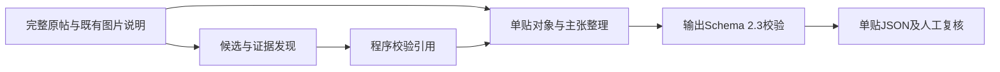

# V2.3 字段修订与框架

用户已确认四项调整；在完整V2.2契约上局部修改，再生成阶段Prompt，不先压缩定义。完整版本为full-v2.3.md，输出Schema版本2.3，历史2.1/2.2资料保留。

| 旧字段/结构 | V2.3 | 含义 |
|---|---|---|
| experience_type | experience_basis | 明确亲历/明确非亲历/无法判断/不适用，判断作者直接经历依据 |
| statement_type | 保留 | 表达性质；评价可以来自亲历，两者不互相替代 |
| claim.comparison的A/B单对 | product_ids＋relations | claim内部的多对象比较；关系逐条附证据，不推导所有组合 |
| sentiment_score | sentiment_intensity | 弱/中/强/无法判断；中性使用null，仅情感表达强度 |
| 无使用情境字段 | claim.usage_context | summary＋evidence；无明确情境用null |

## 字段边界

- experience_basis不取代经历的具体叙述；旧预期、假设和泛泛观点含义仍在statement_type/content中保留。试驾是亲历，不能因此证明拥有。
- relation使用优于/弱于/相当/存在差异但方向不明/无法判断，以subject相对object为准。更贵、更快、更大不自动等于更好。个人选A不自动等于A优于B。
- 多产品整体表达保留原文，不自动补传递关系。关系不存在时comparison=null，content仍保留有用比较内容。
- 中性→强度null，不明确→强度无法判断。有情感的其余方向不能使用null。强度不是故障严重度、研究重要性或真实性。
- 使用情境随具体主张，而非长期用户画像；不将一段高速工况赋给整帖。计划、假设或图片来源必须保留限定。

## 框架

只修改既有两阶段的契约，不为经历依据、情感强度或情境额外调用模型。Prompt/Schema变化必须使客户端阶段缓存失效；不能宣称已命中服务端缓存，需读API usage。

## 兼容与验证

根级仍为原九字段，四项修改发生在claims内部。Schema 2.3拒绝experience_type、sentiment_score和根级comparison。旧版仍按旧Schema读取，不能将旧分数机械映射为强度，也不能猜旧输出的亲历依据和情境。

7项V2.3检查覆盖有效输出、旧字段拒绝、比较自关联/悬空对象/重复逆关系、情境证据、强度条件和逐节迁移。程序只能检查结构与引用，不能证明证据解释正确，也不能证明未推导关系。

当前运行器仍是旧契约实现；本次交付V2.3完整Prompt、拆分Prompt、Schema与独立验证器，尚未接入100条运行。不得用旧运行入口生成结果后改schema_version冒充2.3。

## 后续实际状态（2026-10-16）

上述“尚未接入”是本Prompt修订时点的历史状态；现已接入V2.3运行器并完成v23-run2的100帖影子对照及随机20帖复核。最终75/100通过本地门槛，语义未获得人类验收，完整报告见collaboration/result/auto016-modular-post-extraction/v23-run2/reports/。不将结构合规当语义准确率。
