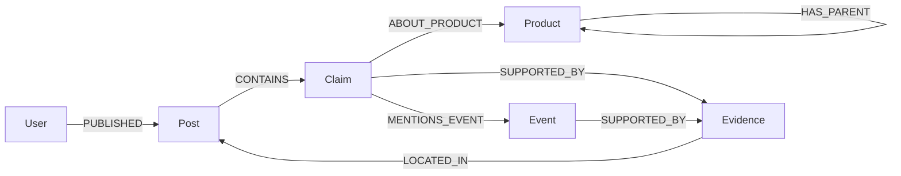

# Design

## Context

动机及授权边界见 proposal.md。本文件是可执行实施计划的设计输入，所有“导入、校验、查询”均为待实现行为，不是已经跑通的结果。

### 1. 已检查的事实与依赖

| 输入 | 本地位置 | 用途与限制 |
|---|---|---|
| V2.3 修复抽取 | `collaboration/result/auto016-modular-post-extraction/single-v23-full-repair1/contract-passed.jsonl` | 原 Claim/产品/事件/用户状态；保留中文枚举、局部 ID 和原对象 |
| 冻结原文 | `collaboration/result/auto016-modular-post-extraction/single-v23-full/inputs/<post_id>.json` | 文本 block 或图片说明 block；图片说明不是原图核验 |
| 元数据 | `collaboration/data/004_A4_图片策展_主链路终版.csv` | 以字符串 post_id 连接 URL、时间、平台账号键，不按标题连接 |
| 用户资料 | `G:/Download/user_profiles.csv` | 资料抓取快照；按user_id核对author_home中的同平台数字ID；不补持有车辆、预算或历史状态 |
| 产品映射 | `collaboration/result/auto018-product-entity-normalization/v2/delivery-r3/mention-mapping.jsonl` 与 `taxonomy.json` | 单提及最深落点、祖先、规则依据、待复核原因；不视为官方车型库 |
| 配置快照 | `G:/Download/su7_配置明细_长表.csv` | 用户提供的参数快照；同 specid 分组；74430 为猜想图，不能作为量产配置 |
| 离线报告证据 | `collaboration/result/auto018-product-entity-normalization/report-v1/analysis/` | 已保存的范围配置、统计和反例；不是人类语义金标 |
| 单帖契约 | AUTO-016 `schemas/post-output-v2.3.json`、`tools/post_contract_v23.py` | 读取规则及兼容边界，不修改；原校验可容忍同 block 的有序省略片段 |

现有报告记录 9,529 帖、26,936 个 Claims、15,002 个产品提及。这里复查的是已保存的分析产物及源契约，不声称本轮重新完成全量统计或语义验收。当前 Claim 有 aspect/content/sentiment，没有独立的规范化细粒度产品属性。

AUTO-017 规划以 need_signals 替代 claims，尚未实施；本版明确适配 V2.3，不以 AUTO-017 完成为前置。AUTO-019 是未实施的算子骨架，不复用、不补写、不删除。正式 specs 当前为空；不提前同步本提案。

## Goals / Non-Goals

**Goals:**

- 六类业务实体、配套记录的字段、键、外键、版本、基数均可直接据此编写 Schema 和适配器。
- 不重抽全量，先无损接入，再逐条增加明确有依据的属性和对象限定标注。
- 任意统计能回答“哪批数据、哪些帖子、哪个对象、什么属性、谁说的、证据在哪里”。
- 保留冲突、未知、范围外和失败记录；结构符合、可定位、语义接受、外部核验分开管理。

**Non-Goals:** 图数据库部署、RDF/OWL 全套本体、Agent 算子、聊天或报告 UI、新主题模型、新付费 API、跨平台身份拼接、市场满意度／故障率、外部事件因果识别。业务图不新增 Aspect、Sentiment、Scenario、Need 节点。

## Decisions

### 2. 三层结构与物理交付

1. **原始保留层**：原文件保持只读；`source_files`、`snapshots`、`source_records` 登记指纹与定位，原对象完整保存在 source_records.payload。
2. **规范模型层**：六类实体和配套表采用 UTF-8 JSONL 作为交换契约；SQLite 作为待审批的本地验证默认存储（外键和事务开启）。不在 SQLite JSON 字段中隐藏必须跨记录连接的外键。
3. **派生分析／图投影层**：从一批规范模型生成探索视图、严格视图、六类节点 JSONL 和关系 JSONL；不把图数据库当唯一事实源。未来可增加 Neo4j/RDF 导出，但不是第一版依赖。

选择理由：当前数据规模允许先验证模型和引用，避免先部署服务再发现实体与证据含义错误。替代方案是直接写图数据库或全部作为嵌套 JSON；前者增加运维，后者难查对象配对和外键。本提案不锁定未来数据库品牌，锁定的是交换契约和可见行为。



Post.user_context、产品提及、字典、比较和属性标注是配套记录，不算新增业务实体。图只是一种投影，不丢弃配套结构。

### 3. 类型、空值和版本通则

- `text` 是非空 UTF-8 字符串；可空字段明确标 `?`。空字符串不代替 null。数组缺失不同于空数组；V1 导出字段固定、空集合用 []。
- 日期时间使用带时区 ISO 8601。源元数据无时区时，按当前平台导入配置 `Asia/Shanghai` 解释并记录该假设；原字符串同时保留。仅日期使用 YYYY-MM-DD，不伪造零点精度。
- 年款、specid、帖子 ID、平台账号键为字符串，不转浮点或科学计数法。bool 不使用 0/1 字符串。confidence 为可空 number，区间 [0,1]。
- 本地 SQLite 中 JSON 数组／对象存为经 JSON Schema 验证的 TEXT；bool 以 0/1 + CHECK 表示；查询用的多值外键放连接表。
- 公共字段：每条规范／派生记录都带 `run_id`、`record_hash`；模型／规则产生的判断带 `review_state`。表下列字段省略这些公共列。
- `review_state=unreviewed|needs_review|accepted|rejected`；accepted 必须关联实际人类复核记录。Codex 审查建议记入 checks/advisory，不自动写 accepted。
- 外部事实用独立 `verification_status=unverified|source_checked|corroborated|disputed`。source_checked 只证明核对过该来源，非“客观绝对真实”。
- 同一键不同内容不得 UPSERT 覆盖；输出冲突并新建版本批次。不存在“最新写入即为真”的规则。
- record_hash 使用规范字段的确定性 JSON（keys排序、UTF-8）计算，排除 record_hash 自身、派生review_state和导入时间；审核状态根据指向相同内容hash的review_decisions计算，避免“接受后状态变了导致审核指纹立即失效”。原文/目标/属性/情感/证据改变必须改变内容hash。
- 每个实体/派生记录带 source_record_id 与 source_pointer；source_records.payload 按源JSONL的整帖根对象或CSV行保存，指针如 `/claims/0` 指向具体成员；不靠仅保留Claim来声称可以重建九根字段。引用多个来源时使用source_refs数组列出全部(source_record_id,pointer)，保留一个主来源。

### 4. 全局 ID 与自然键

| 对象 | 全局 ID / 自然键 | 范围 |
|---|---|---|
| User | `user:autohome:<SHA256(normalized_platform_key)>` | 同平台账号；规范化主页去 query/fragment、保留区分大小写的路径，仅小写 host；无法取得键则 Post.user_id=null，不共用 unknown 用户 |
| Post | `post:autohome:<source_post_id>` | 稳定帖子键；一个运行只选一份冻结快照 |
| Claim | `claim:autohome:<post_id>:<local_claim_id>` | 不使用局部 C1 单独作主键；不同运行内容可不同 |
| Product | 直接复用 AUTO-018 已有 node_id | 不重算或更换 ID；不以可变显示名为键；root 只用于目录结构，不作为目标产品 |
| Evidence | `evidence:<SHA256(snapshot_id, block_id, source_type, exact_quote)>` | 哈希输入为有序 JSON 数组 UTF-8；不在身份哈希中删除标点／空白；同证据可被多个记录引用 |
| Event | `event:autohome:<post_id>:<local_event_id>` | 第一版局部提及键，canonical_event_id=null，不按标题合并 |
| Mention | `mention:autohome:<post_id>:<local_product_id>` | 指向原对象、归一结果与范围判断 |
| Comparison | `comparison:<claim_id>:<source_relation_index>` | 数组下标从 0 开始，必须保留原序与源指纹，不用车型对覆盖重复历史 |
| Property annotation | `annotation:<source_claim_id>:<review_or_rule_id>:<item_index>` | 新标注版本产生新记录，保留旧记录 |

除 runs 自身以 run_id 为PK外，业务、来源及配套记录的物理主键带 run_id：单对象为 `(run_id, entity_id/record_id)`，连接表为 run_id加下文所列组合键。Post 引用 User、Claim 引用 Post 等采用同 run_id 复合外键；自然键列额外 UNIQUE。证据哈希使用完整 64 位十六进制，碰撞按内容比对报告错误。图导出一次只包含一个 run_id，节点 ID 为稳定业务 ID，run_id 作为属性。

`dataset_id=SHA256(按相对角色名排序的原始输入文件SHA256清单)`；不含本机绝对路径、执行时间。`run_id=SHA256(dataset_id + mapping_hash + scope_hash + dictionary_hash + adapter_version + model_schema_version)`，输入串编码为确定性 JSON 数组。生成时间另记，不能影响幂等 ID。代码改变却忘记升级 adapter_version 时，代码指纹不符必须阻断。

### 5. 六类实体字段字典

下列 PK/FK 均在同一 run 内；`ref` 表示逻辑外键。未列出的原字段不丢弃，放 source_records.payload，不允许未知字段被悄悄丢掉。

#### 5.1 User → users.jsonl

| 字段 | 类型/必填 | 来源/约束 |
|---|---|---|
| user_id | text / 是 | 上节账号键；PK |
| platform | text / 是 | 固定 autohome |
| platform_key_hash | text / 是 | 规范化账号键指纹；不是匿名化保证 |
| display_name | text? | 元数据昵称，仅受限本地表，不导出公开分析包 |
| identity_scope | enum / 是 | platform_account，不输出 verified_person |

不存永久 age/budget/ownership，不按昵称合并。主页原值仅留受限 source_records，报告／图导出不携带。

#### 5.1a 用户资料快照（配套记录，不新增业务实体）

`user_profile_snapshots`：profile_snapshot_id text PK、user_id ref User、platform_user_id text（受限源关联键）、nickname text?、sex_raw text?、sex_label_raw text?、sex_source text?、sex_normalized enum(male/female/unknown)、sex_basis enum(platform_field/pronoun_inferred/unknown)、following int?、followers int?、ip_location_raw text?、csv_location_raw text?、post_count_in_dataset int?、fetched_at datetime、fetched_at_raw text、status text、error text?、source_record_id ref、source_locator int。公共run_id/record_hash规则相同。

- 账号键：`user_profiles.user_id`须与home_url路径数字ID一致，再和metadata.author_home路径数字ID连接；User稳定键仍使用上节规范化主页，以避免悄悄改变旧ID算法。昵称不参与连接。
- profile_snapshot_id由User键、fetched_at_raw及完整CSV行内容hash确定；同一账号不同抓取时间可多条，不覆盖历史。支持表不是新的Profile业务节点，资料在User详情中按快照展示。
- following/followers为非负整数或null；post_count_in_dataset只是该CSV来源数据集的统计，不能替代本轮抽取子集帖数或平台总帖数。fetched_at无时区按Asia/Shanghai解释并记录假设。
- sex_source=hdsex时按源1/2映射male/female，称平台资料标签；代词推断仅保留原label，sex_normalized=unknown、sex_basis=pronoun_inferred，不能混入直接字段分组。其他值unknown，不按昵称推断。
- IP属地、原CSV地域分列；不解释为常住地，不用资料抓取日状态回填历史帖子。缺失非零；status=ok仅代表抓取状态。
- 在论坛原文之外以source_record_id+CSV行定位，不伪造论坛Evidence。快照和原文默认本地受限；图User节点只带派生键，交互详情可查看受限快照，但不输出昵称、主页、数字原ID。

2026-10-19前一轮只读检查：5349个唯一ID、9701条元数据作者全部匹配，抓取于2026-10-11；这是此前检查而非当前试建计数，试建须重算抽取集覆盖、失败、缺失及推断字段。

#### 5.2 Post → posts.jsonl

| 字段 | 类型/必填 | 来源/约束 |
|---|---|---|
| post_id / source_post_id | text / 是 | 全局键与源字符串；PK/自然键 |
| user_id | ref User? | 无稳定键保持 null |
| platform / forum_context | text / object | autohome；SU7 论坛仅是来源上下文 |
| title / source_url | text / text? | 原标题；URL 移除敏感参数，原始 URL 留源层 |
| published_at / published_at_raw | datetime? / text? | 元数据；不得用 collected_at 替代 |
| collected_at | datetime? | 源有采集时间才填，不能用本轮导入时间冒充 |
| snapshot_id | ref Snapshot / 是 | 对应冻结原文 |
| summary / post_topic / analysis_value | text / enum / enum | 逐项复用 V2.3；不解释为人工质量评分 |

UserContext 交换时嵌入 Post；本地一对一拆表 `post_contexts(post_id PK/FK, ownership_status_raw, journey_raw, age_raw?, budget_raw?, preferences_json, extraction_confidence?)`，证据在 record_evidence。对象限定状态另见 6.6。

#### 5.3 Claim → claims.jsonl

| 字段 | 类型/必填 | 来源/约束 |
|---|---|---|
| claim_id / local_claim_id / post_id | text / text / ref Post / 是 | 组合键，不靠内容去重不同作者的表达 |
| content | text / 是 | 原 content；不是来源作者逐字原话 |
| claim_type / statement_type | enum / 是 | 原 V2.3 分类及表达性质，不合并为一个字段 |
| aspect_code / aspect_raw | ref Dictionary / text / 是 | 18 个既有方面一对一编码；无法判断也保留对应代码 |
| sentiment / sentiment_intensity | enum / enum? | 逐项复用，不把正负混合强转正或负；中性强度 null |
| experience_basis / journey_stage | enum / enum / 是 | 原中文枚举；不把不适用强改成非亲历 |
| usage_context | object? | 原 summary + evidence 对象，不拆出未经证据确认的温度／身高 |
| extraction_confidence | number? | 原 confidence，不当真实性概率 |
| source_record_id | ref SourceRecord / 是 | 保存完整原对象；schema_version=2.3 |

claim_targets、claim_events、comparison_records、property_annotations 为子记录，不能把它们展平成重复 Claim 后再计算 Claim 数。

#### 5.4 Product → products.jsonl

| 字段 | 类型/必填 | 来源/约束 |
|---|---|---|
| product_id / canonical_name | text / text / 是 | 复用 node_id/label |
| level | enum / 是 | brand / series / configuration；root 不进入业务节点 |
| parent_id | ref Product? | brand 无业务父节点，series→brand，configuration→series |
| specid | text? | 只有明确配置填；同来源 specid 唯一；猜想图不得进入 |
| scope_role | enum / 是 | target / comparison_candidate / ancestor；不声称市场直接竞品 |
| catalog_status | enum / 是 | corpus_reference / source_snapshot / externally_checked；当前默认前两种 |
| source_node_id | text / 是 | 可回查旧 taxonomy |

年款／版本未知组合不新增节点；具体配置年款从其明确 catalog 引用读取，提及中的年款／版本留 mention attributes。HAS_PARENT 是目录结构，不声明 Brand 是 Vehicle 的子类，不无条件继承子配置参数。

#### 5.5 Evidence → evidence.jsonl

| 字段 | 类型/必填 | 来源/约束 |
|---|---|---|
| evidence_id / snapshot_id / block_id | text / ref Snapshot / text / 是 | 三者可定位冻结输入 |
| post_id | ref Post / 是 | 当前主证据为帖子；配置出处另用 property value source_ref，不伪造 Post |
| source_type | enum / 是 | text / image_summary，与原 block 类型匹配 |
| quote | text / 是 | 保留原字节语义，不能修成便于匹配的新引文 |
| match_status | enum / 是 | exact / normalized / segmented / mismatch / missing_source |
| spans | array<object> / 是 | 0-based Unicode code-point 半开区间 [start,end)，针对原 block 文本/summary；非 exact 可以是多片段或 [] |
| check_rule_version | text / 是 | 校验规则标识，与 semantic review 分离 |

normalized 仅允许 NFKC、统一空白及原契约指定的纯标点格式差异，保留定位映射。与旧契约一致的省略号有序多段兜底记 segmented，不冒充连续引文；mismatch/missing_source 仍保留记录。读取失败影响该证据，不自动删除整帖其他可用证据。

#### 5.6 Event → events.jsonl

| 字段 | 类型/必填 | 来源/约束 |
|---|---|---|
| event_id / local_event_id / post_id | text / text / ref Post / 是 | 局部提及作用域 |
| name / summary | text / text / 是 | 原字段；摘要不是核验结论 |
| event_type / event_status_raw | enum / enum / 是 | 复用 V2.3 的 11 类事件类型及发生状态，不降成只有 policy/tech/public_voice 三类 |
| event_time_raw | date? | 原 event_time |
| time_precision / time_basis | enum / enum / 是 | 原字段仅日期则 date / model_extracted；未知为 unknown；不由发布日期补事件发生时间 |
| canonical_event_id | text? | V1 固定 null，跨帖归一不在实施范围 |
| verification_status | enum / 是 | 默认 unverified，作者说已发生不等于外部核实 |
| extraction_confidence | number? | 原字段 |

事件产品引用保存在 event_targets，引用产品提及；不得丢掉范围外对象的原引用。

### 6. 配套表及关系契约

#### 6.1 来源、批次与审阅基础设施

| 表/交换文件 | 必要字段 | PK/约束 |
|---|---|---|
| source_files | source_id, role, sha256, relative_locator, source_kind | source_id；绝对读取路径只在本地 run 配置，不放公共图 |
| snapshots | snapshot_id, source_id, source_post_id, sha256, blocks_json | snapshot_id；source_post_id为来源字符串而不是Post外键，避免与Post.snapshot_id循环；frozen post JSON内容不可变 |
| source_records | source_record_id, source_id, locator, payload, payload_hash | 原始 JSON 对象；locator 为 JSONL 行号或 CSV 数据行号（均 1-based） |
| runs | run_id, dataset_id, schema_version, adapter_version, code_hash, scope_hash, dictionary_hash, created_at, completed_at?, status | status=staging/validated/published/failed；时间不参与自然键 |
| review_decisions | review_id, target_table, target_id, target_record_hash, reviewer, reviewed_at, verdict, note, evidence_ids | verdict=accept/reject/revise；只认实际人类审阅，旧内容审批不随新版本继承 |

raw payload 属于受限离线包，不自动放入用户可分享的图／报告包。source_kind 必须区分 forum_extraction、forum_metadata、frozen_post、catalog_snapshot、manual_review。

#### 6.2 产品提及与目标引用

`product_mentions`：mention_id、post_id、local_product_id、raw_name、original_product_json、product_id?、mapping_status、scope_status、resolution_level?、model_year?、trim?、generation?、resolution_basis_json、mapping_rule_version、source_record_id、review_state。

- mapping_status=resolved / ambiguous / unresolved / excluded，AUTO-018 mapped 显式映射为 resolved；review_required 独立保留并可将 review_state 设为 needs_review。
- scope_status=in_scope / out_of_scope / not_resolved / excluded；product_id 只在 resolved 且 in_scope 时非空，旧 node_id 留 `source_node_id`，不能变成悬空图边。
- `claim_targets`：claim_id、mention_id、role_raw，PK=(claim_id,mention_id,role_raw)；role_raw 复用六种 V2.3 角色。
- `event_targets`：event_id、mention_id；PK=(event_id,mention_id)。
- `claim_events`：claim_id、event_id、relation_raw、relation_interpretation=author_or_model_assertion；每条 V2.3 配对非空才导入。保留“事件事实／明确影响判断／可能影响判断／态度反应”原值，不导出 CAUSES。

导入输入引用一个根本不存在的局部产品／事件时为 E_FK；对象存在但范围外不是结构错误。归一落点不清楚的 Claim 仍存在。
所有局部提及、事件、证据与其owner的post_id必须一致；即使外键对象存在，跨帖误连也报 E_CROSS_POST_REF。

#### 6.3 属性字典

`property_dictionary`：dictionary_version、property_code、name、aspect_code、parent_code?、aliases[]、allowed_value_types[]、unit?、definition、allowed_levels[]、status。PK=(dictionary_version,property_code)，parent_code 引同版本，无环。allowed_value_types是number/text/boolean/evaluation的非空子集；evaluation仅允许属性评价，不能作为客观配置值入库。

`aspect_dictionary` 使用现有 18 个中文方面逐项确定编码；完整固定映射如下，不改变原方面语义，业务图不生成 Aspect 节点：

| code | 原值 | code | 原值 |
|---|---|---|---|
| range_energy | 续航与能耗 | charging | 充电与补能 |
| driving_handling | 驾驶与操控 | assisted_driving | 智能驾驶 |
| cockpit | 智能座舱与车机 | space_comfort | 空间与舒适性 |
| exterior_interior | 外观与内饰 | power_performance | 动力与性能 |
| safety_quality | 安全与质量 | reliability_fault | 可靠性与故障 |
| price_cost | 价格与成本 | configuration_function | 配置与功能 |
| service_delivery | 服务与交付 | brand_reputation | 品牌与口碑 |
| technical_principle | 技术原理 | policy_market | 政策与市场 |
| other | 其他 | unknown | 无法判断 |

细粒度种子建议如下（定义尚待人类批准，不声称全量已标）：

| property_code | 名称 | 允许值类型 | 所属方面 |
|---|---|---|---|
| rear_seat.thigh_support | 后排腿部支撑 | [text,evaluation] | 空间与舒适性 |
| rear_seat.headroom | 后排头部空间 | [number,evaluation]；单位仅明确时填 | 空间与舒适性 |
| rear_seat.backrest_adjustable | 后排靠背可调 | [boolean,evaluation] | 配置与功能 |
| hud.readability | HUD可读性 | evaluation | 智能座舱与车机 |
| voice.response | 语音响应 | evaluation | 智能座舱与车机 |
| parking.interruption_recovery | 泊车中断恢复 | [text,evaluation] | 智能驾驶 |
| charging.power_display | 充电功率显示 | [number,evaluation]；明确数值单位kW | 充电与补能 |
| delivery.promise_consistency | 交付承诺一致性 | evaluation | 服务与交付 |

V1 可全部保持 property_annotations 未标注状态而完成无损导入，但不能因此声称完成细粒度需求分析。属性种子不是分类模板强填规则；需要先做有证据的样本标注，再决定是否扩展。

#### 6.4 客观配置值

`product_property_values`：value_id、product_id、dictionary_version、property_code?、mapping_status、property_name_raw、value_raw、value_number?、value_text?、value_bool?、unit?、source_id、source_locator、observed_at?、valid_from?、valid_to?、verification_status、conflict_group_id?。

- 来源为配置表，不是 Claim；至少保存 raw 字段。只有明确定义及单位转换规则时填类型化值，number/text/bool 最多一个非空，无法转换时保留 raw 而非猜值。
- mapping_status=mapped/pending_dictionary；mapped要求property_code存在且引用有效字典，pending_dictionary要求property_code=null，不丢弃长表行。
- 只有 specid 确定、范围内且非猜想图的配置可接值；可选配置扩展参数由 scope 配置显式开启，不为所有竞品展开配置。
- 同源完全相同行可去重但保留 source_locator 列表；同配置同属性来源冲突时保留多个 value_id，不覆盖，不自动求平均或选择“最新真值”。
- observed_at 缺失不等于本轮导入时间，valid_* 未知留 null。源表“在售”只是快照状态，不宣称当前仍在售。

#### 6.5 属性评价与比较

`property_annotations`：annotation_id、claim_id、target_mention_id、dictionary_version、property_code、sentiment?、evaluation_text、evidence_ids（交换字段，入库拆连接）、context_json?、origin、method_version、review_state、annotation_group_id?、source_record_id。

origin=explicit_source / analyst_inferred；方法身份在 method_version 中区分 deterministic_rule/codex/human；它们不代表已批准。每条必须恰好一个 Claim、一个目标提及、一个属性、至少一条同帖证据。目标产品可范围外，但这种标注不进入产品图。

没有精确绑定时不建属性评价，只在 `annotation_gaps` 记录 claim_id、reason=unassigned/multiple_targets/mixed_sentiment/insufficient_evidence。不从粗 aspect 自动推细属性；不把混合情感复制给多个属性。

`comparison_records`：comparison_id、claim_id、source_relation_index、subject_mention_id、object_mention_id、aspect_code、property_code?、relation_raw、evidence_ids、context_json?、review_state。

主客体保留源方向；relation_raw=优于/弱于/相当/存在差异但方向不明/无法判断。重复检测的规范键允许反转“弱于”作对照，但不改原对象、不删除原记录。不同帖不同场景的相反评价不是错误。缺属性可按方面比较；缺范围内产品保留局部比较，不算入完整车型对统计。

第一版不新增 Comparison 业务节点；图中的 COMPARES_SUBJECT / COMPARES_OBJECT 边带 comparison_id，不允许任意配对。需要纯二元无属性 RDF 导出时必须升级设计，不能丢限定信息；本版不是该适配器。

#### 6.6 对象限定的用户状态

`user_product_contexts`：context_id、post_id、mention_id?、product_id?、ownership_status_raw、journey_raw、evidence_ids、as_of、origin、review_state。

原 user_context 一对一复制到 post_contexts，不自动生成对象限定记录。当前 V2.3 缺 ownership_product_id；由独立样本复核得到对象限定，未明确则 product_id=null，不能与 Claim 主要对象或 forum_context 直接连接。

“自述持有SU7”严格集合要求同一帖子中的 context accepted、product_id 指向 SU7 或其明确配置、状态为当前拥有、证据明确为作者自述；这依然不是实名／车辆认证。试驾、租车单独保留；不得建立跨时期永续 User OWNS Product 边。

#### 6.7 证据连接

`record_evidence`：owner_type、owner_id、evidence_id、purpose，PK=(owner_type,owner_id,evidence_id,purpose)。owner_type 允许 claim/event/product_mention/post_context/user_product_context/comparison/property_annotation；实现时分别建立对应实体连接表，以取得可执行 FK，不用无法检查的多态外键替代。

purpose=statement / target_resolution / context / comparison / annotation。连接表均带 run_id 和同运行外键。配置表来源用 source_ref+行号，不伪造论坛 Evidence。角色证据不够时不把“同帖有一段话”视为对所有关系都有效。

### 7. 产品范围与属性分类的版本管理

建议 `product-scope/1.0-draft` 先固定当前报告临时名单：小米 SU7；特斯拉 Model 3、Model S；极氪001、007；比亚迪汉；保时捷Taycan；尚界Z7；阿维塔12。它是从语料比较相关共提及中得到的分析范围，不是经过市场验证的竞品名单。

- 这份提案把名单作为明确的默认草案，待 Owner 批准。导入时必须读冻结配置，不能每次按 Top-N 改名单。scope_config 保存 nodes/role、include_configurations（默认仅SU7已有明确specid）、版本及理由。
- 所有必要品牌祖先均包含；已知范围外车系不降成“品牌表达”混入统计，只有原本只能识别品牌的提及才落品牌。
- 重点品牌新增或替换、配置展开、属性定义变化均升级 scope/dictionary 版本，运行 ID 随之变化。raw mentions 永远不因范围变化被删除。
- 旧版本已有 Product 稳定 ID 继续复用；品牌级聚合与车系级聚合分开去重，不将父子合计相加。

### 8. 现有字段到新模型的逐项映射

| 现有路径 | 目标 | 处理 |
|---|---|---|
| output.post_id | Post.source_post_id | 字符串原样；与输入／元数据严格连接 |
| metadata.author_home | User平台键 | 规范化后生成派生账号键，昵称只显示不合并 |
| metadata.created_at | Post.published_at | 明确本地时区假设，保留原字符串 |
| input.blocks[] | Snapshot.blocks_json | 全量原样保存，文本与图片说明分开 |
| output.claims[].id/content | Claim键/content | 全量保存，未归一产品也不能删Claim |
| claim.aspect | aspect_code+aspect_raw | 18值固定映射，不新增语义 |
| claim.sentiment/statement_type/experience_basis等 | Claim同义字段 | 中文枚举原样；confidence改名只影响派生契约 |
| claim.target_products[] | claim_targets→product_mentions | 只连接该帖局部ID；角色不改写 |
| claim.evidence[] | Evidence+claim_evidence | 原文完整保留，重新打定位状态而非改源证据 |
| claim.usage_context | Claim.usage_context | 原 summary/evidence 对象保留，不自动填场景字段 |
| claim.comparison.relations[] | comparison_records | 按source_relation_index保留，证据按每条比较挂接 |
| claim.related_event_id/event_relation | claim_events | 成对校验，明确影响判断仍是原表达 |
| output.events[] | Event+event_targets+event_evidence | 局部作用域，不自动跨帖归一 |
| output.user_context | Post.user_context / post_contexts | 不补ownership_product_id，不迁为永久User属性 |
| mapping.node_id/ancestor_ids | Product+product_mentions | 先按范围配置过滤节点，原落点存source_node_id |
| mapping.attributes | Mention.model_year/trim/generation | 未知保持null，不能为了组合造节点 |
| 配置长表specid及参数 | ProductPropertyValue | 非猜想且明确配置；source_snapshot，非外部已验证 |
| 目前不存在的细粒度属性 | property_annotations | 首次导入不填；另做可复核标注，不伪装源字段 |

所有九个根字段和原对象都能从 source_records 重建。适配中发现源 Schema 漂移时整批报 E_SCHEMA_DRIFT，不套用 AUTO-017 兼容猜测。

### 9. 关系、基数与图投影

| 关系 | 源→目标 | 基数/限定 |
|---|---|---|
| PUBLISHED | User→Post | Post有0或1个User；一个User可多帖 |
| CONTAINS | Post→Claim | Claim恰好属于1帖；保留原局部ID |
| ABOUT_PRODUCT | Claim→Product | 0..N；每条边含target_mention_id、role_raw、review_state、mapping_rule_version；不合并不同角色 |
| HAS_PARENT | Product→Product | 每个series/config恰好1父节点；brand无业务父节点 |
| SUPPORTED_BY | Claim或Event→Evidence | 1..N原引用可保留；分析门另检查定位状态 |
| LOCATED_IN | Evidence→Post | 恰好1帖、一个指定snapshot及block |
| MENTIONS_EVENT | Claim→Event | 0..1源关系；包含relation_raw；不产生影响用户的事实边 |
| INVOLVES_PRODUCT | Event→Product | 0..N，来自event_targets，保留mention_id |
| COMPARES_SUBJECT / COMPARES_OBJECT | Claim→Product | 每个完整comparison_id各1条；scope外端点不画边；记录不丢 |

节点properties仅公开必要分析字段；User默认只导出派生键和identity_scope；Post不导出author_home、author_nick或原文中的未审阅个人信息。Evidence引文属于可识别内容，不自动公开；默认产物为受限本地包。节点／边导出外键和计数与规范表对账。

### 10. 三种查询口径与六个验收问题

- **raw**：逐源记录可回读，保留未知／失败／范围外，不做结论。
- **exploratory**：Claim至少一条exact/normalized证据可定位，产品范围可靠；各字段携带未复核提示。若某一Claim证据另有mismatch，保留 `partial_evidence=true`，不能让一条有效引文掩盖未被支持的内容；默认方面／情感统计还要求该Claim全部证据为exact/normalized。segmented 单列复核，不静默改变旧契约通过数。
- **strict**：本次分析使用的 Claim语义、对象归属、属性标注及所需Context分别有人类accepted记录，至少一条支撑该结论的exact/normalized证据。其他非相关证据的失败保留披露；无实际接受则返回零及原因。不因严格集合少而偷偷降门。

| 编号 | 要回答的问题 | 查询逻辑与验收 |
|---|---|---|
| Q1 | SU7各方面有多少正负表达？ | claims→claim_targets→mentions→products；只用唯一可确认主要讨论对象为SU7且无已抽取comparison的Claim；eligible Claim全证据门；COUNT DISTINCT claim_id/post_id分别返回，标注模型比较可能漏抽 |
| Q2 | 后排腿部支撑具体哪里不好？ | accepted的property_annotations指定property_code，绑定SU7目标提及→原Claim→Evidence；返回场景未知率与原文，不把attribute的缺标当没问题 |
| Q3 | 自述持有SU7与试驾用户表达有何不同？ | 通过已复核user_product_contexts分别构建帖子时点集合；未知单列；同账号不同时点可换组，不宣称实名身份 |
| Q4 | SU7与Model3在哪些方面有明确比较？ | comparison_records逐条配对、保持原方向，过滤两端scope可靠；按comparison/Claim/post三个口径分别计数，不用整体情感代替比较方向 |
| Q5 | 某具体配置的参数与用户反馈是什么？ | product_property_values按明确specid与来源读取；反馈连接同配置或仅车系分别标注，不强配未知年款；冲突值并列 |
| Q6 | 某事件相关表达有哪些证据？ | claim_events→局部Event→Evidence；按event_time与post_time分列，不输出因果或跨帖同名自动合并结果 |

Q1负面占比=同方面eligible负面Claim数/该方面全部eligibleClaim数（含中性/混合/不明确），另列排除原因；不是用户不满意率。属性级Q2必须按属性评价记录的独立sentiment计算，不能沿用原Claim混合sentiment。所有返回均带run_id、scope_version、dictionary_version、counts、excluded_counts与evidence_refs。

### 11. 示例：混合评价、未知产品与试驾反例

以下为教学用结构示例，不是已导入产物；省略公共列与部分原始字段。

```json
{
  "claim": {"claim_id":"claim:autohome:example:C1","content":"SU7好看，但后排大腿托不住","aspect_raw":"空间与舒适性","sentiment":"正负混合"},
  "target": {"mention_id":"mention:autohome:example:P1","raw_name":"酥妻","product_id":"<复用SU7的AUTO018 node_id>","scope_status":"in_scope","resolution_basis":["forum_context","alias"]},
  "annotation": {"property_code":"rear_seat.thigh_support","sentiment":"负面","evaluation_text":"后排大腿托不住","target_mention_id":"mention:autohome:example:P1","origin":"explicit_source","review_state":"unreviewed","evidence_ids":["<同一post的Evidence键>"]},
  "post_context": {"ownership_status_raw":"当前拥有","evidence_ids":["<提到我的A3的Evidence键>"]},
  "user_product_context": {"product_id":null,"ownership_status_raw":"当前拥有","origin":"explicit_source","review_state":"needs_review"}
}
```

解释：别名可以归SU7，但“我的A3”不支持拥有SU7。细粒度标注为候选，不自动接受；外观正面若没有另建明确标注，不复制出来。配置未知留车系。范围外对比对象的 mention.product_id=null，raw_name和comparison局部引用保留。

### 12. 未来实现接口与文件所有权

下面仅指定未来文件，不在本轮创建或执行。

| 路径 | 责任/接口 |
|---|---|
| `tools/forum_evidence_model/schema.py`、`schemas/forum-evidence-model/1.0/` | 六类及配套记录的JSON Schema、枚举、键和FK验证 |
| `tools/forum_evidence_model/adapt_v23.py` | 无损适配；禁止调用模型或网络 |
| `tools/forum_evidence_model/validate.py` | 结构／引用／证据／范围／状态检查，返回结构化issues |
| `tools/forum_evidence_model/export.py` | JSONL、SQLite与图nodes/edges的同源导出 |
| `tools/forum_evidence_model/query.py` | 离线六个验收查询，不暴露Agent工具或HTTP服务 |
| `tools/forum_evidence_model_cli.py` | build/validate/query本地CLI入口 |
| `configs/forum-evidence-model/` | 冻结scope、aspect/property字典、证据规则 |
| `tests/test_forum_evidence_model_*.py`、`tests/fixtures/forum-evidence-model/` | 最小样例、结构反例、回归及只读真实样本键 |
| `collaboration/result/auto020-forum-evidence-model/<run_id>/` | 数据生成位置；不得覆盖其他Change产物 |

Codex单写者，接口负责人为本Change人类Owner；本提案不启用并行AI写入。未来委派必须指明任务号、基线、允许文件和测试，不允许修改AUTO-016/017/018共享契约。若原文件用户修改与提案假设冲突，停止受影响写入并向Owner报告。

命令契约（待实现）：

```text
python tools/forum_evidence_model_cli.py build --source <v23.jsonl> --inputs <frozen_dir> --metadata <csv> --mapping <jsonl> --taxonomy <json> --scope <json> --dictionary <dir> --catalog <optional_csv> --output <new_dir> --dry-run
python tools/forum_evidence_model_cli.py build <相同参数，不带--dry-run>
python tools/forum_evidence_model_cli.py validate --run <dir>
python tools/forum_evidence_model_cli.py query --run <dir> --id Q1 --mode exploratory --output <new_json>
```

dry-run只读输入，返回摘要和预计表清单，不建DB、不写输出目录。实际build要求output不存在；已存在返回E_OUTPUT_EXISTS，重跑幂等通过相同record IDs和新临时输出验证，不覆盖已有包。

完成包：manifest.json、runs/source_files/snapshots/source_records、六类实体JSONL、全部配套表JSONL、model.sqlite、nodes.jsonl、edges.jsonl、issues.jsonl、validation.json、scope/dictionary副本、README。query输出默认不含昵称主页；raw payload单独标restricted且不进入nodes/edges。

### 13. 错误与发布规则

| 错误码 | 级别/处理 |
|---|---|
| E_SCHEMA_DRIFT / E_PK / E_FK / E_CROSS_POST_REF | error；禁止发布，原输入保留；外键存在也不能跨帖误连局部记录 |
| E_SCOPE_CONFIG / E_TAXONOMY_CYCLE / E_HASH_CONFLICT | error；禁止发布，不能重算或改名绕过 |
| E_SOURCE_MISSING | error若缺整个必需文件；局部block缺失记证据missing_source并隔离相应分析 |
| E_OUTPUT_EXISTS / E_INPUT_MUTATED | error；停止，不覆盖或修源 |
| W_QUOTE_SEGMENTED / W_QUOTE_MISMATCH | needs_review；保留Claim，按查询门排除或披露 |
| W_TARGET_UNRESOLVED / W_TARGET_OUT_OF_SCOPE | review/info；不建无根据产品边，保留提及 |
| W_PROPERTY_UNASSIGNED / W_MIXED_SENTIMENT | review；不填属性级结论 |
| W_CONTEXT_PRODUCT_UNKNOWN | review；不加入产品持有者集合 |
| W_CATALOG_CONFLICT / W_COMPARISON_DUPLICATE | review；并列保留，不当场裁决 |

issues每行固定：run_id、table、record_id、code、severity、field、source_record_id、message、suggested_action；不包含凭证。没有error才能将status从staging→validated，并在数据／图／manifest对账后published。published仅指本地完整数据包状态，不代表上传网站或人类验收。

事务及目录策略：先用目标父目录中的显式新暂存目录，文件和SQLite全部完成验证后rename为指定output；失败暂存目录保留，manifest写failed，不用定时清理删除证据。回滚仅切回旧run引用，不改原文件或删除旧批次。

### 14. 实施验收矩阵

| 门 | 目标/方法 | 不代表什么 |
|---|---|---|
| G1 源闭合 | 适配前后源哈希100%一致；所有输入帖子、Claim、提及逐键accounted for（保留或带理由隔离）；0未报告丢失 | 不代表抽取正确 |
| G2 结构 | PK/FK、枚举、父链、comparison配对、schema版本检查0个error；每种反例测试能报指定code | 不代表语义正确 |
| G3 对账 | 原始counts=规范records+显式隔离；一对多连接不放大Claim数；nodes/edges与规范表逐键对账；第二次构建ID一致 | 不代表市场代表性 |
| G4 查询 | Q1–Q6均有结果或明确空结果解释，关键计数独立重算；证据回溯到同snapshot/block | 不代表所有场景都覆盖 |
| G5 定向语义复核 | 建议最多200条review packet：120条属性评价候选（8个种子各15条，不足全取且不补造）、40条比较、40条用户对象状态；组间可重叠但分别报unique claim/post数；fixed seed=20261018，另附已知反例定向集 | 不是随机总体准确率 |
| G6 接受门 | 属性／目标／情感／证据／Context五项按适用项逐项评阅；无明确错误且全部适用项由人类accept才进strict；任何“他车/租车误认SU7持有”反例未解决则该严格人群视图不得交付为可用 | 不强造通过率，不用程序pass替代人类接受 |

G5先由Codex生成待审包和建议，人类Owner实际评阅才写review_decisions。数量是建议的实施默认范围，可在规格批准时调整；属性不足明确报告，不能依赖未经授权的全量LLM调用补足。探索模型可以先交付并标明strict无足够接受记录；不得把严格层未完成计为语义通过。

### 15. 方法来源与适配界限

以下原始资料已在2026-10-18前一轮讨论中联网核查，本轮复用其稳定建模模式，不声称重新查询了网页或这些规范强制要求本项目表结构。

- [W3C n-ary relations](https://www.w3.org/TR/swbp-n-aryRelations/)：带多个参与者／限定的关系保留为有上下文记录；是设计模式说明，不是把所有属性节点化的要求。
- [W3C PROV-O](https://www.w3.org/TR/prov-o/)：借鉴来源与生成活动追溯；V1用run与source引用实现，不要求完整PROV本体部署。
- [W3C SKOS Primer](https://www.w3.org/TR/skos-primer/)：借鉴标准名、别名、层级；本项目第一版为字典表，不将方面画成业务实体。
- [Schema.org PropertyValue](https://schema.org/PropertyValue)：属性标识／值／单位记录思路；时间与审核字段是本项目补充，不冒充Schema.org原字段。
- [W3C SHACL](https://www.w3.org/TR/shacl/)：借鉴基数／类型／约束报告；V1用JSON Schema与FK等价验证，不声称SQLite输出就是SHACL验证。

## Risks / Trade-offs

- [六类业务实体仍需多张配套表] → 明确业务视图与物理表不同；配套表解决来源、版本、配对，不增加Aspect等业务对象。
- [没有现成细粒度属性] → 首次导入留空且报缺标，样本标注后再扩大，不从aspect猜填。
- [严格视图可能很少甚至为空] → 如实返回，不降语义门；探索层仍可用于线索发现，但必须标明边界。
- [产品／用户状态误识别] → 复用证据与待复核标记，严格人群需对象限定和人类接受。
- [本地SQLite包含原文与派生账号键] → 默认受限离线，不自动发布；散列不称匿名化，外发需要单独脱敏审查。
- [原契约宽松证据兜底与分析门不同] → 保存segmented等状态及排除计数，不重写旧PASS结果，不称新门为已证明的准确率。

## Migration Plan

1. Owner审阅proposal/spec/design，记录审阅人、日期、commit与未决项；确认默认scope和采样门。此步骤尚未发生。
2. 在独立开发分支/合适隔离工作区实施，不移动当前dirty工作树；冻结输入manifest、字典和scope。
3. 先最小fixture验证键、证据和配对，再做只读dry-run；确认无schema漂移及输入缺失后构建独立全量离线包。
4. 生成定向复核包，回读人类结果后再生成strict视图；所有未接受记录仍保留探索/原始层。
5. 完成Q1–Q6对账、图投影、复现与交接，再由人类决定是否接业务；不在本Change接Agent或重新抽取。
6. 回滚使用旧run，原V2.3、AUTO018及旧报告保持原样。PR合并与Owner接受后，另按项目维护流程同步正式specs/归档。

## Open Questions

没有影响字段和接口的隐藏待决项：上文已给出本地SQLite、固定草案白名单、8个属性种子、最多200条复核包的明确建议默认值，均属于待审提案，不是已获实施批准。Owner可以审阅时修改；修改涉及范围／接口时先同步四份artifacts。

可后置且不影响本版契约的事项：人类Owner实名、最终PR编号、将来是否选择具体图数据库品牌。人类规格批准、代码审查、数据语义验收与交付接受仍分别待做。

## Authorized exploratory pilot — 2026-10-19

用户确认的P1–P3独立于上述24项正式实施：读取全部现有V2.3抽取、冻结原文、AUTO018目录/映射、元数据和用户CSV；输出六类节点、带来源限定的边、提及/比较/用户资料快照等辅助JSONL、源hash清单、校验和离线HTML预览。不创建SQLite，不声称满足完整Schema、全部Q1–Q6或strict验收；属性标注留空，配置值导入不属于这次图连接试建，不能伪造其覆盖。

允许文件：专用工作区 `tools/auto020_graph_pilot.py`、`tools/auto020_graph_pilot.html`、`tests/test_auto020_graph_pilot.py`；数据生成于原项目 `collaboration/result/auto020-forum-evidence-model/pilot-<fingerprint>/`新目录。实施分支 `change/auto-020-forum-evidence-model`，保留原dirty工作树；不推送/提交/PR。输入路径显式传入，不扫描凭证、不调用模型或网络。

预览全量索引按帖子和产品筛选，每次最多画80个可点击节点；超出明示截断且不改变全量导出。提供作者资料快照详情、Claim方面/情感、产品原提及及映射依据、比较配对、Event原状态、证据block/quote/定位状态。缺失/范围外对象不强连。产品范围沿用第7节草案并冻结到manifest；不直接把全部旧673目录节点入业务图。

验证：源文件/实际读取快照哈希前后一致；全量帖/Claim/提及逐键计数；重复ID、悬空边、跨帖局部引用均检查；测试代词性别、未知用户、范围外产品、反向比较、证据精确/缺失及安全HTML转义；构建两次比较稳定输出；打开预览测试筛选和节点详情。所有判断保留unreviewed；pilot_ready仅为试建成功，非正式模型published或语义接受。回滚关闭预览并使用旧包，不删除源或历史输出。

### Pilot evidence — P1

2026-10-19，专用分支`change/auto-020-forum-evidence-model`，工作区`G:/.codex/worktrees/auto020-graph-preview/AutoInsight`，源HEAD仍为`35d6c095dc35c59ef0a5127e16fe601224832553`；尚未提交。生成器和模板/测试仅位于该工作区的允许文件；提案保留在原工作区。

首包`collaboration/result/auto020-forum-evidence-model/pilot-20261019-r1/`的manifest/validation为实际证据：9529帖、26936 Claim、3150局部Event、55209 Evidence、23 Product、5349 User（其中69只有资料未在抽取集发帖）；共100196节点、164103边。5280个抽取作者全部关联资料；元数据9701帖中172未进入抽取集。15002提及全保留，2681条比较原配对保留。文件和9529份冻结输入哈希前后一致，结构错误0。11项单元/最小集成测试通过，不等于全套正式验收。

证据节点定位49546 exact、283 normalized、5380 segmented；引用位置warning为5487次（同一证据多处引用，不能与独立证据数混用）。无人工接受记录。性别直接字段5348、代词推断1，标准化male4958/female390/unknown1。

范围对账：使用冻结白名单映射到稳定canonical node_id后选节点，in_scope=10396/out_of_scope=3682/unresolved=734/excluded=190。较旧report-v1多4条范围内提及：都是同一个Taycan canonical node_id，源series字符串有taycan/TAYCAN大小写差异；旧报告按原字符串白名单排除，本次按同一稳定节点包含。原AUTO018映射未改；这项统计口径差异明确保留，不声称新旧计数完全相同。

### Pilot evidence — P2/P3 and limits

正式预览交接为`collaboration/result/auto020-forum-evidence-model/pilot-20261019-r2/review.html`；本机临时预览URL为`http://127.0.0.1:8895/review.html`，不作为部署服务。r1保留作独立重建对照。两包nodes/edges/mentions/profile snapshots/comparisons/source_records/graph-data.js均SHA256完全相同，run_id相同。r2仅对展示模板做SVG适配和同引文去重，图数据未改。完整实测记录见r2/pilot-checks.json，截图见r2/preview.png。

浏览器验证：全量索引载入；用户资料抓取时间与地域/性别来源详情；SU7+空间与舒适性+负面筛选得到309帖（仅整帖筛选，不等于目标限定分析样本）；Claim详情及quote回溯；无匹配搜索返回0帖/0节点。80节点上限和提示按代码检查，真实本批选中子图未触发超过80的浏览器状态；未做手机模拟。11测试包含范围外产品/未知用户/原比较方向与反向重复、幂等最小fixture等，不代表正式模型全部要求通过。

单份包在追加截图及检查记录前实测403126976 bytes，其中graph-data.js=114882295 bytes、source_records副本=114179304 bytes；这是带重复交换/预览/来源副本的验证包，不是必需存储下限或线上性能基准。本轮未调用模型，无新增模型推理费用；没有测量云资源价格或总体运营成本。用户关于聚合后存储的讨论尚未授权改成新的存储实现；建议明细为依据、聚合作派生读模型、图按需投影，不能用聚合覆盖明细。

试建P1–P3已完成，原24项正式任务仍未实施；代码未提交、未推送、未创建PR，人类代码审查与语义接受仍待做。原数据/原工作树业务文件均未修改。
